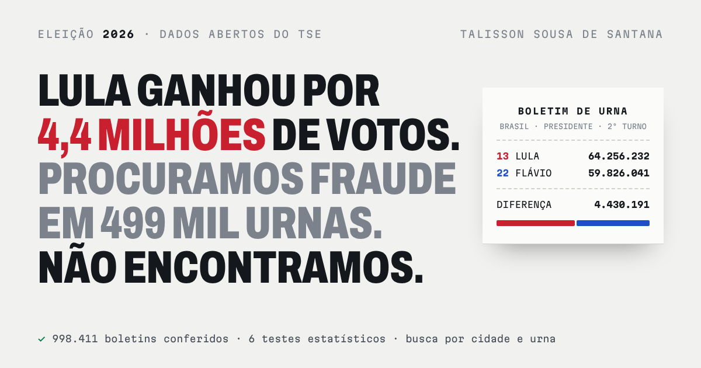

<div align="center">

# Eleição 2026: os dados abertos do TSE, urna por urna

**Os números da eleição presidencial de 2026 conferidos e explicados só com dados públicos.**

[](https://talissonsousa10-ship-it.github.io/eleicao-2026/)
[](LICENSE)


[](https://talissonsousa10-ship-it.github.io/eleicao-2026/)

</div>

## 📌 O que é

No 2º turno de 2026, Lula teve **64.256.232** votos e Flávio Bolsonaro, **59.826.041**. Depois do resultado, circularam alegações de que a eleição foi roubada, muitas delas com argumentos matemáticos.

Este repositório testa essas alegações com os arquivos que o **Tribunal Superior Eleitoral** e o **IBGE** publicam para qualquer pessoa. Também explica onde e por que a eleição foi decidida. Todo o código está aqui, e qualquer pessoa pode refazer as contas.

| Número | O que representa |
|---|---|
| **998.411** | boletins de urna conferidos com a totalização oficial, campo a campo |
| **443 mil** | urnas com o mesmo eleitorado nos dois turnos, usadas para estimar as transferências de voto |
| **5.570** | municípios com os votos conferidos e disponíveis no mapa |
| **6** | testes estatísticos de fraude; os testes por zona também foram rodados em 2022, para comparar |

## 🗺️ O site

O site tem três páginas: **[talissonsousa10-ship-it.github.io/eleicao-2026](https://talissonsousa10-ship-it.github.io/eleicao-2026/)**

| Página | O que mostra |
|---|---|
| **A eleição passou no teste** | Seis testes estatísticos, a conferência dos boletins de urna com a totalização e a checagem de 11 alegações |
| **Onde foi decidida** | De onde vieram os votos do 2º turno, um simulador para testar teses de transferência, a comparação com 2022 e o perfil dos municípios |
| **Explore sua cidade** | Mapa com zoom e busca por cidade, local de votação e urna |

## 🔍 O que encontramos

### A contagem bate
- Os 998.411 boletins dos dois turnos (o papel afixado na porta de cada seção) são idênticos à totalização oficial em todos os campos. Os 56 arquivos `bweb` têm o hash SHA-512 igual ao publicado pelo TSE.
- Nenhuma urna tem mais votos que eleitores presentes, nem mais presentes que eleitores aptos. A soma das urnas bate com o total oficial em todas as zonas.

### Os testes não encontram sinal de fraude
- O último dígito dos votos é uniforme (p = 0,65 para Lula, 0,71 para Flávio).
- O 1º turno prevê o 2º com R² de 0,99. As 36 zonas fora do padrão se dividem em 14 a favor de Lula e 22 a favor de Flávio.
- As urnas antigas não votam diferente das novas na mesma escola (diferença de 0,06 ponto).
- As urnas que destoam das vizinhas são 0,13% do total e já votavam assim no 1º turno (397 de 398).
- Em 2022, o mesmo padrão aparece com o sinal trocado. Bolsonaro virou 251 municípios entre os turnos; Lula virou 211 em 2026.

### Onde a eleição foi decidida
- **Conta exata:** a virada veio de quem não tinha votado em Lula nem em Flávio no 1º turno. Somados, os dois ganharam 14,1 milhões de votos, e 74% desse ganho foi de Lula.
- **Estimativa** (inferência ecológica): pelo modelo das urnas, o grupo que mais pesou foi o de quem não votou em ninguém (entre 6,0 e 6,2 milhões para Lula, contra 0,1 a 0,9 milhão para Flávio). Os eleitores dos outros candidatos se dividiram quase ao meio. Pelo método das zonas, os outros candidatos foram mais para Flávio (32% × 57%). A divisão entre os dois grupos é a parte menos certa.
- **Simulador:** testa sete teses de transferência, cada uma com uma faixa provável (90% de 200 reamostragens de municípios). Só duas viram o resultado: todos os eleitores dos outros candidatos indo para Flávio, ou quem não votou no 1º turno continuando sem votar.
- **Comparado a 2022:** Flávio cresceu nas cidades pequenas e recuou nas grandes.
- **Perfil das urnas:** dentro da mesma cidade, urnas com mais eleitores de pouca escolaridade deram mais vantagem a Lula (17 pontos de diferença entre a quinta parte com menos e a com mais diplomados). Jovens e mulheres pesaram para Lula, mas menos. A virada entre os turnos foi parecida em todo tipo de urna. A pesquisa Datafolha mostra o mesmo padrão.

### ⚠️ Limites
- Os dados mostram como cada lugar votou, não como cada pessoa votou.
- Testes estatísticos não substituem a auditoria das urnas.
- Os arquivos analisados são do próprio TSE. Falta comparar uma amostra de boletins fotografados por fiscais.

## 🗂️ Estrutura

```
.
├── *.py               programas da análise (ordem de execução abaixo)
├── analise/           resultados de cada etapa, prontos para conferir
├── dados_ibge/        indicadores do Censo 2022 e PIB 2023 por município
├── dados_mapa/        contornos dos municípios e tabela de códigos TSE × IBGE
├── site/              código-fonte do site (React + TypeScript + Tailwind)
└── docs/              site publicado no GitHub Pages, com os dados da busca por estado
```

## 🔁 Como refazer as contas

Requisitos: Python 3.11+ (`pip install -r requirements.txt`). Para gerar o site de novo, também Node 18+ e pnpm.

### 1. Baixe os arquivos do TSE

Os arquivos vêm do [Portal de Dados Abertos do TSE](https://dadosabertos.tse.jus.br/), conjuntos [Resultados 2026](https://dadosabertos.tse.jus.br/dataset/resultados-2026) e [Resultados 2022](https://dadosabertos.tse.jus.br/dataset/resultados-2022). Coloque-os nesta pasta ou na pasta acima.

| Arquivo | Uso |
|---|---|
| `votacao_candidato_munzona_2026_BR` | votos por zona |
| `detalhe_votacao_munzona_2026` | aptos, comparecimento, brancos e nulos por zona |
| `votacao_secao_2026_BR.zip` e `votacao_secao_2022_BR.zip` | votos por urna, com o nome e o endereço do local de votação |
| `perfil_eleitor_secao_2026_<UF>.zip` (conjunto [Eleitorado 2026](https://dadosabertos.tse.jus.br/dataset/eleitorado-2026)) | idade, escolaridade e sexo dos eleitores de cada seção |
| `detalhe_votacao_secao_2026.zip` | aptos, comparecimento, modelo da urna e hora de chegada do boletim |
| `dados_2022/detalhe_votacao_munzona_2022_BR.csv` | 2022 por zona |
| Boletins de urna (`bweb_*`) | baixados por `python baixar_boletins.py`, que confere o SHA-512 de cada arquivo |

### 2. Rode os programas, nesta ordem

| Programa | O que faz | Saída |
|---|---|---|
| `analisar.py` | resultado por zona, 1º e 2º turno | `analise/zona.csv` |
| `preparar_2022.py` | a mesma base para 2022 | `analise/zona_2022.csv` |
| `forense.py` (e `forense.py --ano 2022`) | testes por zona: impressão digital, novos eleitores, último dígito, Benford, consistência entre turnos | `analise/forense/` |
| `comparar_anos.py` | 2022 × 2026, município a município | `analise/comparacao_2022_2026/` |
| `preparar_secoes.py` | tabelas por urna | `dados_secao/` |
| `forense_secoes.py` | testes por urna: seções irmãs, modelo de urna, curva da apuração | `analise/forense_secoes/` |
| `conferir_boletins.py` | boletins × totalização, horários, votos manuais, prorrogação | `analise/boletins/` |
| `montar_banco.py --parquet` e `testar_banco.py` | banco DuckDB com tudo (ver `BANCO_LEIAME.md`) | `banco/` |
| `baixar_ibge.py` | indicadores do Censo 2022 e PIB 2023 por município | `dados_ibge/` |
| `analise_decisao.py` | transferências de voto, 2022 × 2026, perfil e regressão | `analise/decisao/` |
| `agregar_perfil_secao.py` | resume o perfil do eleitorado por seção do TSE (`perfil_eleitor_secao_2026_<UF>.zip`, 2,7 GB) em uma linha por seção | `analise/perfil/perfil_secao_2026.csv.gz` |
| `analise_perfil.py` | compara o perfil de cada urna com o resultado, dentro da mesma cidade | `analise/perfil/resultados.json` |
| `bootstrap_simulador.py` | 200 reamostragens das taxas usadas no simulador, para a faixa provável de cada tese | `analise/decisao/simulador_bootstrap.json` |
| `preparar_busca.py` | dados da busca do site, um arquivo por estado, conferidos com o total oficial de cada município | `docs/busca/` |

Os resultados de cada etapa já estão em `analise/`, para quem quiser conferir sem rodar tudo.

### 3. O site

O código-fonte está em `site/`. Para gerar `docs/index.html` de novo, rode `bash site/construir.sh`.

## 📚 Fontes

- Contornos dos municípios: [tbrugz/geodata-br](https://github.com/tbrugz/geodata-br), simplificados com mapshaper (`dados_mapa/geo_uf.mjs`).
- Códigos TSE × IBGE: [betafcc/Municipios-Brasileiros-TSE](https://github.com/betafcc/Municipios-Brasileiros-TSE).
- IBGE: [API de agregados](https://servicodados.ibge.gov.br/api/docs/agregados?versao=3), tabelas 4714, 9537, 10297 e 5938.
- Pesquisas citadas: Datafolha (6 a 8/10/2026) e Quaest (10 a 13/10/2026), com os links na página.

## 👤 Autor

**Talisson Sousa de Santana**, Analista de Dados Estatísticos.

Encontrou um erro? Abra uma [issue](https://github.com/talissonsousa10-ship-it/eleicao-2026/issues).

## 📄 Licença

[MIT](LICENSE) © 2026 Talisson Sousa de Santana. Você pode usar, copiar e modificar o código e o conteúdo, desde que mantenha o aviso de copyright e o texto da licença. Os dados de origem são públicos, do TSE e do IBGE.
